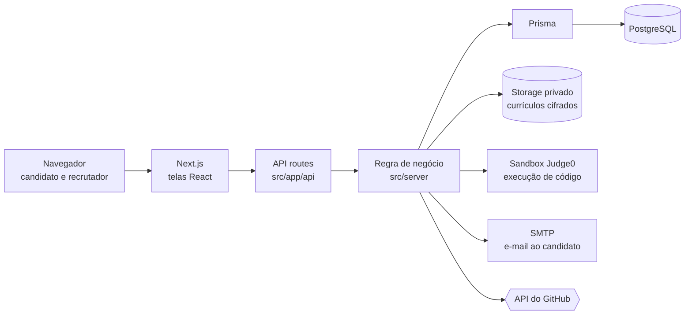

<div align="center">

# CLTech

**Triagem automática, decisão humana.**

Portal de recrutamento técnico: o candidato se inscreve, o sistema analisa o perfil e aplica
um teste de código que se corrige sozinho, e o recrutador decide com dados na mão.

[](https://github.com/daviferreira-dev/CLTech/actions/workflows/ci.yml)
[](https://github.com/daviferreira-dev/CLTech/releases)


**[cltech-3aq.vercel.app](https://cltech-3aq.vercel.app/)**

</div>

> Projeto acadêmico do curso de Análise e Desenvolvimento de Sistemas, Faculdade de
> Tecnologia SENAI Taubaté, 2026, para a demanda da **3aq Tecnologia**.

---

## Índice

- [Por que o CLTech](#por-que-o-cltech)
- [Funcionalidades](#funcionalidades)
- [Telas](#telas)
- [Stack e arquitetura](#stack-e-arquitetura)
- [Como rodar localmente](#como-rodar-localmente)
- [Testes](#testes)
- [Variáveis de ambiente](#variáveis-de-ambiente)
- [Segurança e LGPD](#segurança-e-lgpd)
- [Estrutura de pastas](#estrutura-de-pastas)
- [Documentação](#documentação)
- [Como contribuir](#como-contribuir)
- [Equipe](#equipe)

---

## Por que o CLTech

A 3aq contrata programadores o tempo todo, e o processo era manual:

| Dor | Consequência |
|---|---|
| RH lê centenas de currículos um a um | Bons talentos caem por currículo mal escrito, não por falta de competência |
| Programadores sêniores param para corrigir testes | Os projetos da própria empresa atrasam |
| Dados de candidatos espalhados em e-mails e pastas | Ninguém sabe quem já se candidatou antes |
| Cada avaliador tem um critério | A escolha não é justa nem puramente técnica |

O CLTech automatiza a parte repetitiva (triagem e correção) e deixa a decisão com uma
pessoa. O score de compatibilidade é calculado por regras próprias, sem LLM externo: é
auditável, reproduzível e **imutável** depois de emitido (RN003).

## Funcionalidades

### Candidato

- Cadastro com e-mail e senha ou login com **GitHub** (LinkedIn opcional)
- Perfil profissional completo, com **preenchimento automático pelo currículo** (PDF/DOCX)
- Busca de vagas e candidatura com o **match** do perfil com a vaga
- Acompanhamento das candidaturas etapa por etapa, com aviso por e-mail a cada mudança
- **Teste técnico de código** no navegador, com tentativa única e correção automática
- Direitos do titular (LGPD): baixar os próprios dados e excluir a conta

### Recrutador / Admin

- Criação de vagas e montagem do **pipeline de seleção** (etapas, teste de código)
- **Painel de recrutamento** multi-vaga com o funil de contratação
- Triagem das candidaturas ordenada pelo score de compatibilidade
- Análise detalhada do candidato: perfil, currículo, portfólio do GitHub, resultado do teste
- Busca e histórico de candidatos entre todas as vagas
- Catálogo de desafios de código

## Telas

<!--
TODO: adicionar os prints depois que o redesign (branch design/revisao-nota-10) entrar na main.

Arquivos esperados em docs/screenshots/:
  home.png               página inicial
  vagas.png              lista de vagas
  perfil.png             perfil do candidato
  candidaturas.png       acompanhamento das candidaturas
  desafio.png            teste de código
  painel.png             painel de recrutamento
  candidato.png          análise detalhada do candidato

| Candidato | Recrutamento |
|---|---|
|  |  |
|  |  |
|  |  |
-->

*Em breve.*

## Stack e arquitetura

| Camada | Tecnologia |
|---|---|
| Aplicação | Next.js 15 (App Router), React 19, TypeScript, Tailwind CSS |
| Autenticação | Auth.js (next-auth v5), Argon2id para senhas |
| Dados | Prisma 6 + PostgreSQL 16 |
| Arquivos | Storage S3-compatível privado (Supabase Storage em produção; pasta `.storage/` em dev) |
| Execução de código | Judge0 em sandbox isolado (modo local sem isolamento só em dev) |
| E-mail | Nodemailer via SMTP |
| Testes | Vitest (unit e integration), Playwright (e2e) |
| Deploy | Vercel |



`src/app/api/` é uma casca HTTP fina; a regra fica em `src/server/`, testável sem subir
servidor. Toda rota responde erro no formato único `{ "error": { "code", "message" } }`
(`src/lib/errors.ts`).

As decisões técnicas, com as alternativas descartadas, estão em
[`specs/001-portal-candidatura/research.md`](specs/001-portal-candidatura/research.md).

## Como rodar localmente

Pré-requisitos: **Node.js 24**, **pnpm**, **Docker** e Git.

O jeito mais simples é o ambiente local com Docker. O `pnpm dev:setup`:

1. ajusta o `.env` para o banco local (guarda o anterior em `.env.backup`) e gera
   `AUTH_SECRET` e `ENCRYPTION_KEY`;
2. sobe o Postgres (`docker compose`) com dois bancos: `cltech` (dev) e `cltech_test` (testes);
3. aplica as migrações nos dois e roda o seed no de dev.

Os currículos ficam em `.storage/` e o sandbox roda em modo local. Pode rodar de novo
quando quiser; nada é duplicado.

**Linux / macOS**

```bash
git clone https://github.com/daviferreira-dev/CLTech.git
cd CLTech
pnpm install
pnpm dev:setup
pnpm dev            # http://localhost:3000
```

**Windows (PowerShell)**

```powershell
git clone https://github.com/daviferreira-dev/CLTech.git
cd CLTech
pnpm install
pnpm dev:setup
pnpm dev            # http://localhost:3000
```

Sem Node instalado? `run.bat` (Windows) e `./run.sh` (Linux/macOS) instalam o que falta e
sobem a aplicação.

### E-mail em dev (opcional)

Sem `SMTP_HOST`, `SMTP_USER` e `SMTP_PASS` o envio fica desligado e nada quebra. Para ver os
e-mails, suba o [Mailpit](https://mailpit.axllent.org/):

```bash
docker run -d --name mailpit -p 1025:1025 -p 8025:8025 axllent/mailpit --smtp-auth-accept-any --smtp-auth-allow-insecure
```

No `.env`: `SMTP_HOST="localhost"`, `SMTP_PORT="1025"` e qualquer valor em `SMTP_USER` e
`SMTP_PASS` (o mailer exige os três). As mensagens aparecem em http://localhost:8025.

Contas de demonstração, roteiro de apresentação e problemas comuns:
[docs/manual-execucao.md](docs/manual-execucao.md).

## Testes

```bash
pnpm test:unit          # Vitest, sem banco
pnpm test:integration   # Vitest, no Postgres de teste (cltech_test)
pnpm test               # unit + integration
pnpm test:e2e           # Playwright, contra pnpm build && pnpm start
```

- A suíte de integração dá `TRUNCATE` antes de cada teste: roda só no banco `cltech_test`,
  nunca no de produção.
- O e2e sobe a aplicação em modo produção e roda em série (`workers: 1`).
- O CI (`.github/workflows/ci.yml`) roda lint, `tsc --noEmit`, migrações, `pnpm test` e build
  a cada push na `main` e em todo PR.

## Variáveis de ambiente

Todas estão documentadas em [`.env.example`](.env.example) (e as de teste em
[`.env.test.example`](.env.test.example)). Copie para `.env` e preencha; o `pnpm dev:setup`
já faz isso para o ambiente local. O `.env` nunca é versionado.

| Grupo | Variáveis |
|---|---|
| Banco | `DATABASE_URL` |
| Autenticação | `AUTH_SECRET`, `NEXTAUTH_URL`, `GITHUB_ID`/`GITHUB_SECRET`, `LINKEDIN_ID`/`LINKEDIN_SECRET` (opcional) |
| Criptografia | `ENCRYPTION_KEY` (AES-256, perder a chave torna os dados cifrados irrecuperáveis), `ENCRYPTION_KEY_PREVIOUS` (só durante a troca de chave) |
| Storage | `STORAGE_ENDPOINT`, `STORAGE_BUCKET`, `STORAGE_ACCESS_KEY`, `STORAGE_SECRET_KEY` |
| E-mail | `SMTP_HOST`, `SMTP_PORT`, `SMTP_USER`, `SMTP_PASS`, `SMTP_FROM` |
| Sandbox | `SANDBOX_URL`, `SANDBOX_TOKEN`, `CRON_SECRET` |

## Segurança e LGPD

- **Dados pessoais cifrados** em coluna com AES-256-GCM (`src/server/crypto.ts`); e-mail em
  claro por ser chave de identidade (RN007).
- **Currículos cifrados** em bucket privado, entregues só pelo servidor a quem tem permissão
  (RN004).
- **Sem tokens OAuth guardados**: o login por GitHub/LinkedIn grava só o vínculo da conta
  (`src/server/auth/adapter.ts`).
- **Controle de acesso por papel** (candidato, recrutador, admin), provado por testes de matriz.
- **Logs sem dado pessoal**: erros inesperados são logados sem a mensagem (`logSafeError`).
- **Código de candidato em sandbox** sem rede e com limite de tempo (RNF06).
- **Direitos do titular**: exportação dos próprios dados, exclusão da conta e aviso de
  privacidade em `/privacidade`.
- **Login protegido**: login social só com e-mail verificado pelo provedor, limite de
  tentativas no login e no cadastro, e CSP nos cabeçalhos.

### Trocar a ENCRYPTION_KEY

Telefone, currículos (arquivo e texto extraído) e código dos testes técnicos ficam cifrados
com a `ENCRYPTION_KEY`. Para trocar a chave sem perder nada:

1. Gere a nova: `openssl rand -base64 32`.
2. No ambiente (`.env` ou Vercel), mova a chave atual para `ENCRYPTION_KEY_PREVIOUS` e ponha a
   nova em `ENCRYPTION_KEY`. A aplicação já lê dados das duas e grava só com a nova.
3. Rode `pnpm db:reencrypt` com essas variáveis apontando para o banco e o bucket de produção.
   O script re-cifra o que ainda está com a chave antiga e pode ser rodado de novo sem efeito.
4. Quando ele mostrar tudo zerado, apague `ENCRYPTION_KEY_PREVIOUS`.

Detalhes em [`specs/006-lgpd/spec.md`](specs/006-lgpd/spec.md) e na
[constituição](.specify/memory/constitution.md) do projeto.

## Estrutura de pastas

```text
CLTech/
├── prisma/            Schema, migrações, seed e scripts SQL avulsos
├── src/
│   ├── app/           Telas (App Router) e rotas de API
│   ├── server/        Regra de negócio, sem HTTP
│   ├── components/    UI reutilizável
│   └── lib/           Utilitários (erros, validação, labels)
├── tests/
│   ├── unit/          Vitest sem banco
│   ├── integration/   Vitest com Postgres de teste
│   └── e2e/           Playwright
├── scripts/           dev-setup e checagens de ambiente
├── docker/            Init do Postgres local
├── services/          Reservado (a triagem roda em src/server)
├── specs/             Especificações por feature (Spec Kit)
├── docs/              Manual, deploy, diagramas e entregas acadêmicas
└── DESIGN.md          Identidade visual: cores, tipografia, componentes
```

## Documentação

| Documento | Conteúdo |
|---|---|
| [Manual de execução](docs/manual-execucao.md) | Instalação, contas de demonstração, testes, problemas comuns |
| [Deploy na Vercel](docs/deploy-vercel.md) | Publicação da aplicação |
| [Contratos de API](specs/002-painel-de-recrutamento/contracts/api.md) | Rotas HTTP, corpos, respostas e códigos de erro |
| [Decisões técnicas](specs/001-portal-candidatura/research.md) | O que foi escolhido e por quê |
| [Modelo de dados](specs/001-portal-candidatura/data-model.md) | Entidades, relações e estados |
| [DESIGN.md](DESIGN.md) | Fonte da identidade visual |
| [Diagramas](docs/diagramas/LEIA-ME.md) | Casos de uso, classes, DER, sequência e atividade |
| [Rastreabilidade](docs/rastreabilidade.md) | Requisito → spec → código → teste |
| [ERS v1.1 (PDF)](docs/entregas/CLTech%20-%20ERS%20v1.1.pdf) | Especificação de Requisitos de Software |

## Como contribuir

Leia o [CONTRIBUTING.md](.github/CONTRIBUTING.md). Em resumo: branch a partir da `main`,
commits no padrão `feat|fix|docs(escopo): ...`, testes passando e PR com o template.

## Equipe

Cassiano Luiz Brandes Soares · Davi Ferreira da Cunha · Guilherme Emanuel Gonçalves ·
João Vitor Charleaux · Pedro Henrique Dias Brito · Vinícius Rodrigues Vilaça

**Orientação:** Prof. Wesley Fioreze · **Demanda:** 3aq Tecnologia, via SAGA
